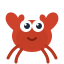

# Learn Rust | 🦀 Interactive Rust Learning Platform

[](https://ecator.github.io/learn-rust/)
[](./LICENSE)
[](https://react.dev/)
[](https://reactrouter.com/)
[](https://tailwindcss.com/)
[](https://vitest.dev/)

An interactive, zero-to-mastery Rust learning web application built as a pure client-side Single Page Application (SPA). Designed with visual clarity, playful mascot guidance, and deep architectural explanations.

- **Live Application**: [https://ecator.github.io/learn-rust/](https://ecator.github.io/learn-rust/)
- **Repository**: [https://github.com/ecator/learn-rust](https://github.com/ecator/learn-rust)

<p align="center">
  
</p>

---

## 🦀 Interactive Example

```rust
fn main() {
    let mut ferris = String::from("Ferris");
    ferris.push_str(" the Crab 🦀");
    println!("Hello, {}!", ferris);
}
```

## 🚀 Key Features

1. **Zero-to-Mastery Progressive Curriculum**
   - 10+ comprehensive modules spanning Cargo, primitive types, ownership & borrowing, memory layouts, enums, trait dispatch, fearless concurrency, and error handling.
   - Code snippets, syntax tokens, and common pitfalls explained with compiler error reproductions and fixes.

2. **6 Interactive Concept Visualizers**
   - **Ownership & Move**: Watch stack pointers transfer, heap chunk lifecycles, and move invalidation.
   - **Borrow Checker & Lifetimes**: Gantt chart timeline of shared (`&T`) vs. mutable (`&mut T`) leases and Non-Lexical Lifetimes (NLL).
   - **Memory Layout & Slices**: Fat pointer dissection (`&str` vs `String`), vector capacity doubling, byte alignment, and Zero-Sized Types (ZST).
   - **Trait Dispatch**: Monomorphization code expansion vs dynamic VTable indirect call jumps.
   - **Fearless Concurrency**: MPSC channel queues, `Arc<Mutex<T>>` contention handoffs, and deadlock detection.
   - **Railway Error Flow**: Step through the `?` operator bifurcating happy and error tracks.

3. **Tri-lingual Localization (i18n)**
   - Native support for Chinese (简体中文), English, and Japanese (日本語).
   - Automatic browser language detection (`navigator.language`) with Chinese fallback.

4. **Dual Theming Engine**
   - Light and dark modes with seamless system preference (`prefers-color-scheme`) tracking and manual override.
   - High-contrast, WCAG 2.1 AA/AAA compliant color tokens.

5. **Ferris Mascot Vector Art**
   - 7 emotional moods (`happy`, `confused`, `safety`, `panic`, `detective`, `speed`, `wizard`).

6. **Privacy-First Local Storage**
   - Progress saved under schema `learn_rust_progress_v1` in `localStorage` with export, import, and reset controls.

---

## 🛠️ Quick Start

```bash
# Clone the repository
git clone https://github.com/ecator/learn-rust.git
cd learn-rust

# Install dependencies using pnpm
pnpm install

# Start local development server
pnpm dev

# Execute E2E and unit test suites
pnpm test

# Build production artifact for deployment
pnpm build
```

---

## 📜 License

Distributed under the MIT License. See [LICENSE](./LICENSE) for details.
